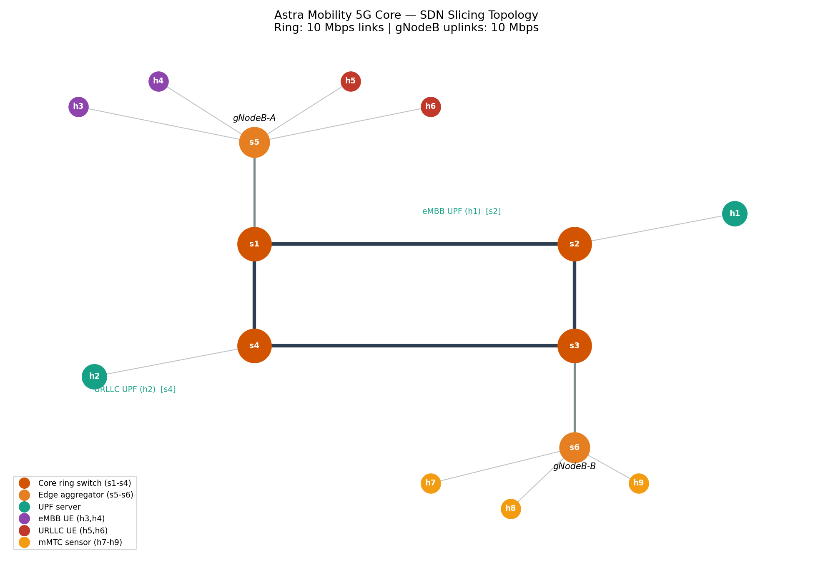
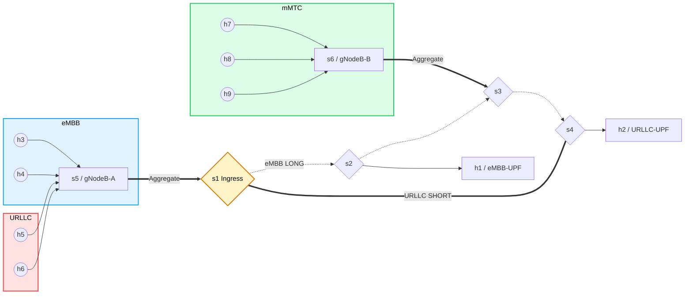

<div align="center">



# Astra Mobility 5G SDN Slicing Lab

### Reproducible 5G mobility and network-slicing experiments

[](src/astra_5g_topo.py)
[](src/astra_5g_topo.py)
[](src/astra_qos.sh)
[](src/astra_controller.py)
[](src/astra_perf.py)
[](#known-scope)

<p>
  <a href="#architecture--slicing-design">Topology</a> ·
  <a href="#running-the-lab">Run the lab</a> ·
  <a href="#observed-results-performance">Results</a> ·
  <a href="#known-scope">Scope</a>
</p>

</div>

Mininet + Open vSwitch + RYU network slicing lab emulating a 5G core fabric.
Three slices (eMBB / URLLC / mMTC) share one physical ring with slice-specific routing, queuing, and rate-limiting.



## Architecture & Slicing Design
- **Core ring**: s1-s2-s3-s4 (10 Mbps links, `delay=2ms`)
- **Edge aggregation**: s5 (gNodeB-A) -> s1, s6 (gNodeB-B) -> s3
- **Paths from s5**: 
  - SHORT `s5->s1->s4` (URLLC, via `s1-eth2`)
  - LONG `s5->s1->s2->s3->s4` (eMBB, via `s1-eth1`)
- **Hosts / slices**: h3,h4 -> eMBB; h5,h6 -> URLLC; h7,h8,h9 -> mMTC; h1 = eMBB UPF (s2); h2 = URLLC UPF (s4)

## Known Scope
QoS enforcement in this lab is uplink-only (UE→UPF); downlink is out of scope.

## Prerequisites & Installation (Arch Linux)

| Package | Purpose | Install |
|---|---|---|
| openvswitch | OVS switch 3.7+ | `pacman -S openvswitch` |
| mininet | network emulator | `pacman -S mininet` |
| iperf3 | traffic generation | `pacman -S iperf3` |
| wireshark-cli | tshark DSCP analysis | `pacman -S wireshark-cli` |
| python-ryu | RYU 4.34 controller | `pip install ryu` (venv, Python 3.9) |
| networkx / matplotlib | charts | `pip install networkx matplotlib` |

RYU is installed in a virtualenv (`/home/anuruprkris/Project/ryu-env`, Python 3.9.25). Mininet lives in system python (`/usr/bin/python`); it is NOT in the venv.

## Repository Structure

```text
sdn/
├── src/                         # Core Python modules and SDN logic
│   ├── astra_5g_topo.py         # Mininet topology (6 switches, 9 hosts, 10 Mbps ring)
│   ├── astra_controller.py      # RYU OpenFlow 1.3 controller app
│   ├── astra_qos.sh             # Linux HTB / OVS QoS configuration
│   ├── astra_monitor.py         # Traffic monitor & DSCP analysis
│   ├── astra_perf.py            # 4-phase slice performance benchmark
│   └── astra_charts.py          # Topology and performance graph generation
├── scripts/                     # Automation scripts
│   ├── run_lab.sh               # Full environment lifecycle runner
│   └── run_benchmark_now.sh     # Quick benchmark runner
├── results/                     # Benchmark measurements and figures
│   ├── astra_results.json       # Aggregate throughput & latency metrics
│   ├── astra_monitor_output.txt # Path DSCP capture analysis
│   └── figures/                 # Generated performance and topology plots
├── pcaps/                       # Packet captures (URLLC short path / eMBB long path)
├── logs/                        # Runtime execution logs (git-ignored)
└── docs/                        # Architecture notes and documentation
```

## Running the Lab

Run the commands from this repository's root directory with the privileges required by Mininet and Open vSwitch. The exact venv path is machine-specific; activate the environment where Ryu is installed.

### Option A: Automated Execution
Run the full lab benchmark automation:
```bash
sudo bash scripts/run_lab.sh
```
Or run the standalone benchmark suite:
```bash
sudo bash scripts/run_benchmark_now.sh
```

### Option B: Manual Step-by-Step

1. **Start the RYU controller** (port 6653, REST on 8080)
   ```bash
   source ../ryu-env/bin/activate
   setsid nohup ryu-manager --verbose src/astra_controller.py ryu.app.ofctl_rest > logs/ryu.log 2>&1 < /dev/null & disown
   ```

2. **Start Mininet** (detached, FIFO-driven CLI)
   ```bash
   mkdir -p logs
   rm -f mn_fifo && mkfifo mn_fifo
   setsid nohup sudo python3 src/astra_5g_topo.py < mn_fifo > logs/mn.log 2>&1 & disown
   setsid bash -c 'exec 3>mn_fifo; sleep 7200' >/dev/null 2>&1 & disown
   ```

3. **Deploy slice QoS**
   ```bash
   sudo bash src/astra_qos.sh
   ```

4. **Monitor slice separation** (tcpdump + tshark)
   ```bash
   source ../ryu-env/bin/activate
   python3 src/astra_monitor.py
   ```

5. **Run the performance benchmark**
   ```bash
   source ../ryu-env/bin/activate
   sudo /home/anuruprkris/Project/ryu-env/bin/python src/astra_perf.py
   ```

6. **Generate Charts**
   ```bash
   source ../ryu-env/bin/activate
   python3 src/astra_charts.py
   ```
   *Charts will be saved to `results/figures/`.*

## Observed Results (Performance)

| Metric | Baseline | Rate-limited | Priority QoS |
|---|---|---|---|
| URLLC throughput | 1.45 Mbps | 8.18 Mbps | 5.40 Mbps |
| URLLC avg latency | 2069.7 ms | 135.0 ms | 46.7 ms |
| URLLC jitter | 289.4 ms | 175.6 ms | 101.6 ms |
| eMBB throughput | 9.52 Mbps | 2.62 Mbps | 3.30 Mbps |

*Note: URLLC latency improved ~44x from Baseline to Priority QoS.*
